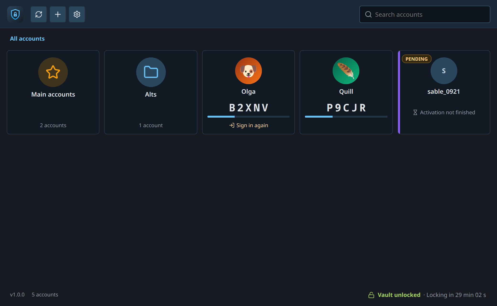
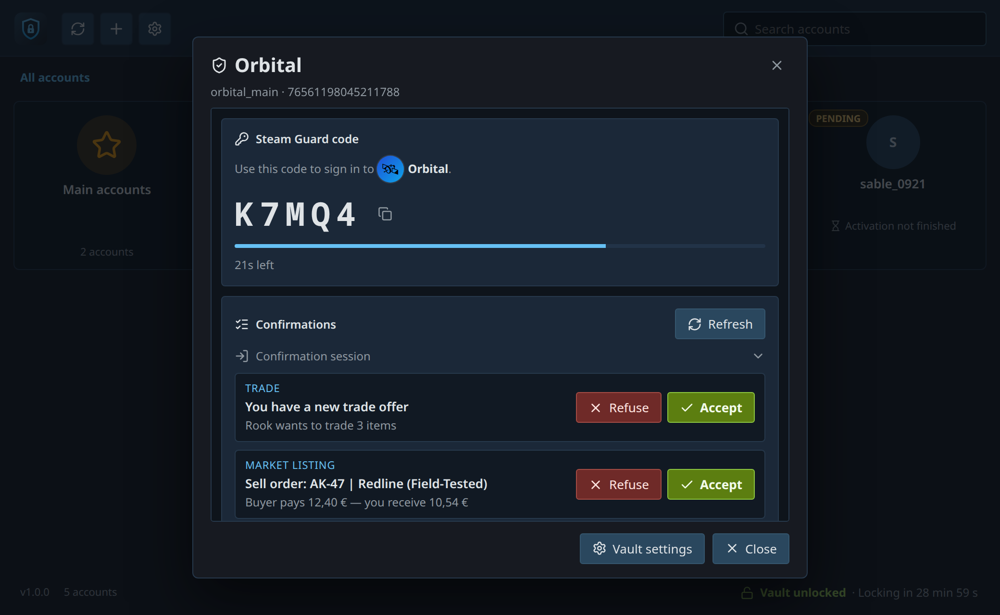
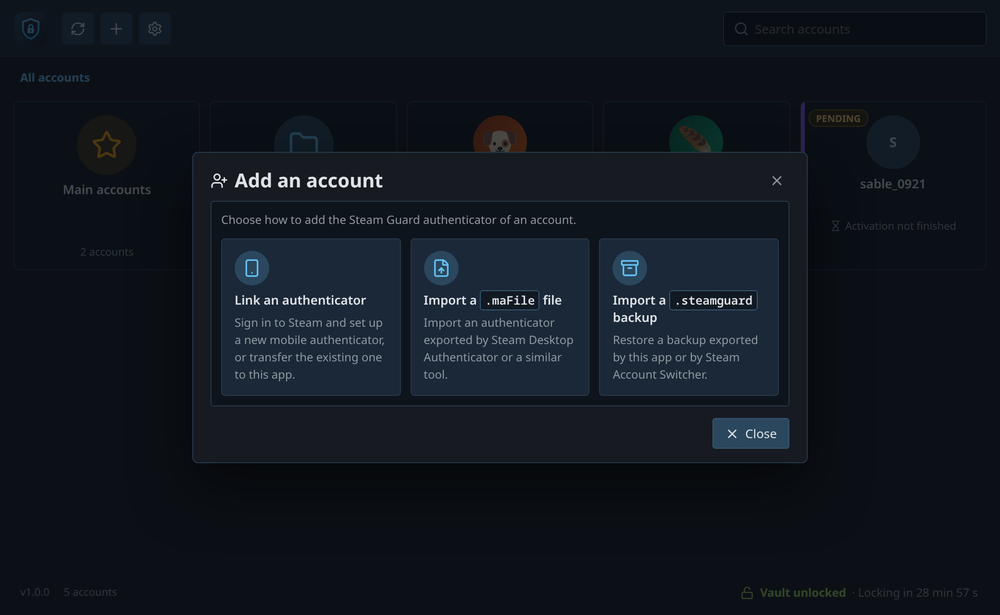
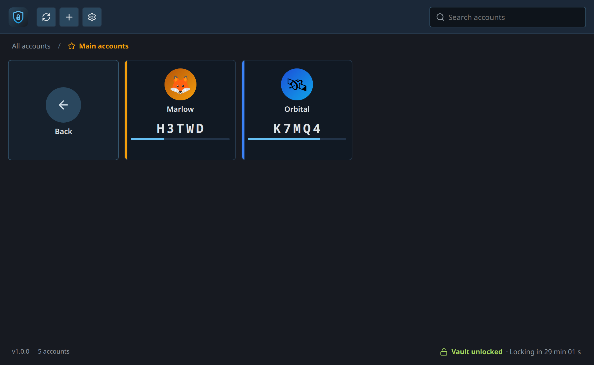
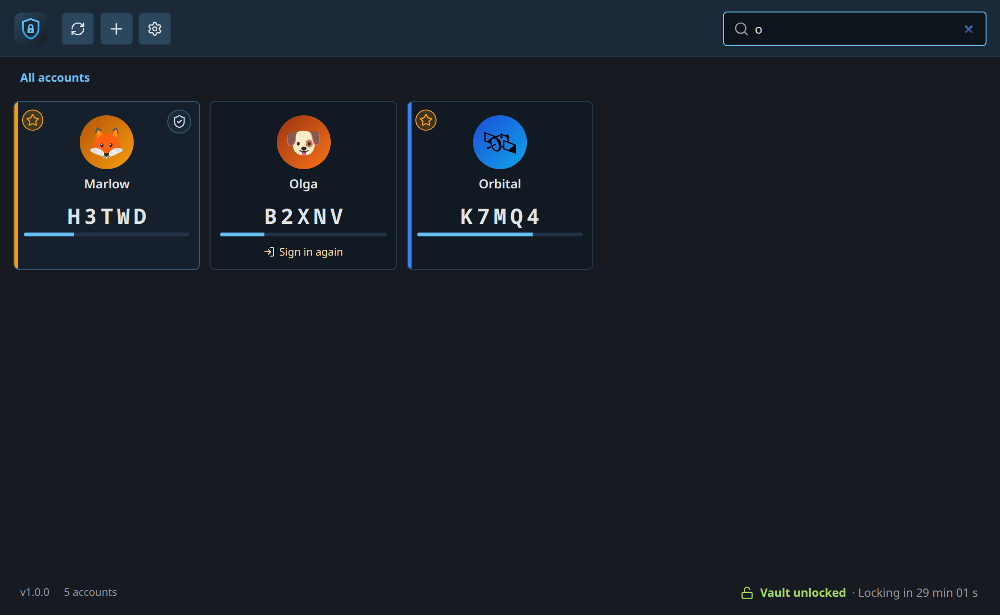
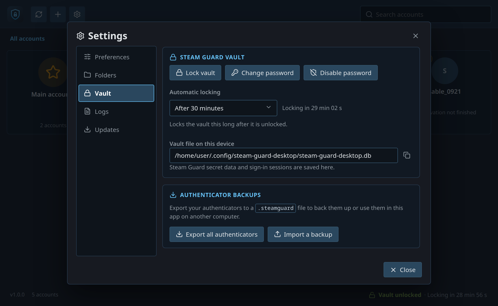
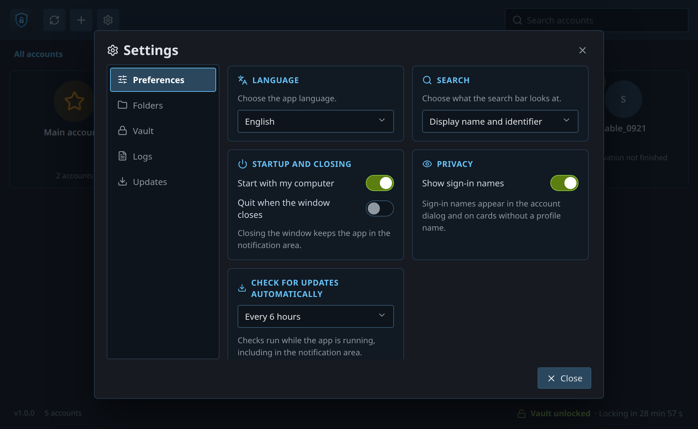

# Steam Guard Desktop



A Steam Guard authenticator for Linux, Windows and macOS.

The application generates the rotating Steam Guard codes on your computer,
approves or denies trade and market confirmations, links a new authenticator to
an account, imports the `.maFile` backups of Steam Desktop Authenticator, and
exports your authenticators to an encrypted backup you can restore on another
machine.

- [**Codes and confirmations**](#accounts) for every account, generated locally,
  with a countdown and one-click copy.
- [**Folders and colours**](#folders) to group accounts.
- [**Encrypted vault**](#vault) protected by Argon2id and AES-256-GCM, with an
  optional password and automatic locking.
- [**Backups**](#backups) of one or all authenticators, plus `.maFile` import, so
  a reinstall or a new computer never means losing access.
- [**Tray icon**](#settings) to copy the current code of any account without
  opening the window.
- [**29 languages**](#settings), the ones Steam speaks, automatic update
  checks, optional start with the system.
- [**Linux, Windows and macOS**](#download): AppImage, RPM, deb, Windows
  installer or portable executable, macOS DMG.

The application never stores your Steam password: sign-in only happens when you
link an authenticator or renew a session, and only the resulting tokens are kept.

## Related project

[Steam Account Switcher](https://github.com/SunkwiBOT/steam-account-switcher)
is a separate application that switches between the accounts remembered by the
Steam client and tracks local playtime, with the same encrypted vault and the
same `.steamguard` backups. The two applications are not linked, but a backup
exported from one imports into the other.

## Accounts

Each card shows the account's avatar and name, its current code and the time
left before the next one. The copy button next to the code copies it; click the
card to open its details. Avatars and persona names come from the public Steam
profile and are cached locally.



The details show the code with its countdown, the pending trade and market
confirmations to accept or refuse, and the security actions: reveal or copy the
revocation code, export this authenticator, remove it from the account (which
revokes it on Steam), or forget it locally. When Steam's session tokens have
expired, the card offers to sign in again.

### Adding an account



The **+** button offers three paths:

- **Link a new authenticator**: sign in with the account's password or by
  scanning a QR code in the Steam mobile app, then confirm with the SMS or
  e-mail code Steam sends. If the account already has an authenticator
  elsewhere, Steam proposes to transfer it with an SMS code.
- **Import a `.maFile`**: the format used by Steam Desktop Authenticator.
  Encrypted maFiles are supported; the passkey is asked only when needed, and
  the `manifest.json` next to the file must be present.
- **Import a `.steamguard` backup** exported by this application or by
  [Steam Account Switcher](https://github.com/SunkwiBOT/steam-account-switcher).

## Folders



Folders have a name, a colour and an icon. Open one to see its accounts, or
right-click it to edit or delete it. Deleting a folder keeps its accounts and
returns them to the main list. Each account can also carry its own colour, shown
as an accent on its card.



The search field looks in every account, including the ones filed in a folder,
and each result shows the folder it comes from.

## Vault



Every secret lives in one local vault, stored in a SQLite database in the
application's configuration folder. The vault is unencrypted by default; setting
a password encrypts it with Argon2id and AES-256-GCM, and the application then
asks for the password after a restart and locks the vault again after the delay
you choose. While locked, the cards still show the accounts, and the tray menu
waits until the vault is unlocked.

## Backups

Export one authenticator or all of them to a single `.steamguard` file,
protected by a backup password of its own or left unprotected on purpose, and
import it on any supported system. Import adds the authenticators that are
missing and keeps the existing ones.

Steam Guard is a security boundary. Keep a backup **and** write down each
revocation code: losing both means the authenticator can only be removed by
Steam Support. Linking, transferring or revoking an authenticator also triggers
Steam trade and market holds, from 2 to 15 days depending on Steam's rules.

## Settings



- **Preferences**: language (system, English or French), start with the system,
  close to the notification area or quit, update check interval, show the
  sign-in names on the cards.
- **Vault**: password, automatic lock delay, backups.
- **Folders**: create, rename, recolour and delete folders.
- **Logs**: the local log keeps categories and durations only, never arguments,
  codes or secrets.
- **Updates**: the application checks for a new version on its own and only
  downloads and installs it when you ask.

The tray menu lists the accounts: clicking one copies its current code.

## Download

Installers are published on the
[releases page](https://github.com/SunkwiBOT/steam-guard-desktop/releases):
AppImage, RPM and deb for Linux, an installer and a portable executable for
Windows, a DMG for macOS. The macOS build is not notarized: right-click the
application and choose **Open** the first time.

## Build

```bash
npm ci
npm run dev:app     # application, interface hot reloaded
npm run build:app   # release executable with the interface embedded
```

Rust and Node 22.12 or newer, plus the
[Tauri prerequisites](https://v2.tauri.app/start/prerequisites/) for your system.

## License

MIT.

## Disclaimer

This project is not affiliated with Valve or Steam. Steam and Steam Guard are
trademarks of Valve Corporation.
